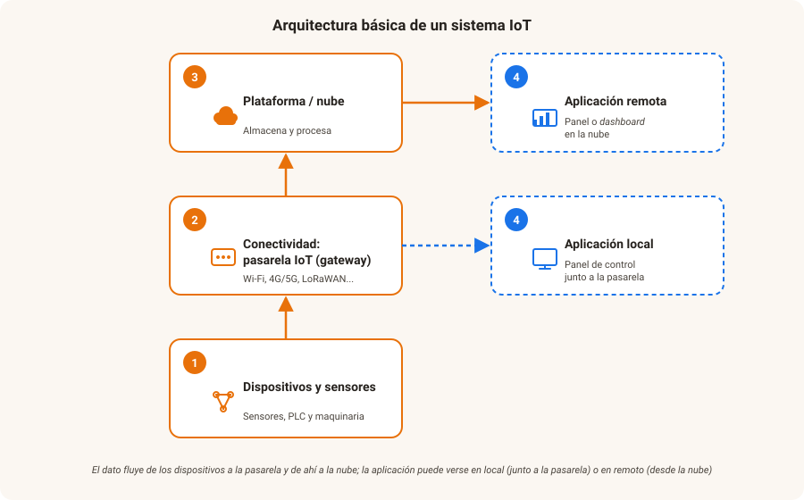
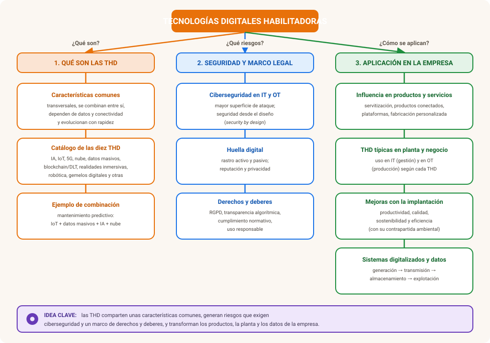

# UD2. Tecnologías digitales habilitadoras

[:material-arrow-left: Volver al índice de todas las unidades](index.md)

!!! abstract "Resultado de aprendizaje"
    **RA2.** Caracteriza las tecnologías habilitadoras digitales necesarias para la adecuación/transformación de las empresas a entornos digitales describiendo sus características y aplicaciones.

## 1. Qué es una tecnología habilitadora

Se llaman **tecnologías digitales habilitadoras** (en inglés, *enabling technologies*) a aquellas tecnologías que, por sí mismas, no resuelven un problema concreto de un sector, pero **hacen posible** que se desarrollen soluciones digitales avanzadas en múltiples sectores a la vez. Son la base técnica sobre la que se construye la Industria 4.0 y, en general, la digitalización de los sectores productivos vista en la UD1.

En esta unidad estudiamos las tecnologías habilitadoras más relevantes y sus características (apartado 2): el Internet de las Cosas, la inteligencia artificial, las redes 5G, la computación en la nube, el procesamiento masivo de datos, blockchain y otras tecnologías de registro distribuido (DLT), las realidades inmersivas, la robótica, los gemelos digitales y otras tecnologías como la impresión 3D o la automatización robótica de procesos (RPA). Por su peso específico, la **inteligencia artificial** y la **computación en la nube** se presentan aquí de forma introductoria y se desarrollan en detalle en las UD4 y UD3, respectivamente. El resto de la unidad analiza su vertiente más transversal —la **ciberseguridad** y la **huella digital** (apartado 3) y el marco de **derechos y deberes** que regula su uso (apartado 4)— y su aplicación concreta en la empresa: su influencia en **productos y servicios** (apartado 5), su papel típico en **planta y negocio** (apartado 6), las **mejoras** que aporta su implantación (apartado 7) y cómo da lugar a **sistemas digitalizados** que generan y explotan datos (apartado 8).

<figure markdown="span">
  { width="820" }
  <figcaption>Las diez tecnologías digitales habilitadoras estudiadas en esta unidad; la ciberseguridad y la huella digital las atraviesan a todas, y la nube y la IA, por su peso, se desarrollan en detalle en las UD3 y UD4.</figcaption>
</figure>

!!! tip "Cómo se relacionan entre sí"
    Estas tecnologías raramente se usan aisladas: un sistema de mantenimiento predictivo típico combina **sensores IoT** (que generan datos), **procesamiento masivo de datos** (que los almacena y procesa), **inteligencia artificial** (que detecta patrones de fallo) y **la nube** (donde se ejecuta todo el proceso).

## 2. Características de las THD

Aunque cada tecnología habilitadora digital (THD) es distinta, todas comparten unos rasgos comunes:

- **Transversalidad**: ninguna resuelve un problema de un solo sector; se aplican en la industria, la sanidad, el comercio, la agricultura...
- **Convergencia**: rara vez se usan aisladas, sino combinadas unas con otras (véase el ejemplo del apartado 1).
- **Dependencia de los datos y la conectividad**: casi todas generan, transmiten o procesan datos, por lo que necesitan infraestructura de red y de almacenamiento.
- **Evolución rápida**: su madurez y su coste cambian con rapidez, lo que obliga a las empresas a actualizar su catálogo tecnológico con frecuencia.

A continuación se presentan las diez THD más relevantes para este módulo.

### 2.1. Inteligencia artificial

La **inteligencia artificial (IA)** es la capacidad de un sistema informático para realizar tareas que normalmente requieren inteligencia humana: reconocer imágenes o voz, entender lenguaje natural, detectar patrones, predecir valores o tomar decisiones. El enfoque dominante hoy es el **aprendizaje automático (*machine learning*)**: en lugar de programar reglas explícitas, el sistema aprende a partir de grandes volúmenes de datos, de ahí su estrecha relación con el procesamiento masivo de datos.

Como tecnología habilitadora, la IA aporta:

- **Automatización cognitiva**: tareas que no son puramente mecánicas — clasificar documentos, atender consultas, inspeccionar piezas mediante visión artificial.
- **Predicción**: mantenimiento predictivo, previsión de demanda, detección de fraude.
- **Optimización**: rutas de reparto, precios, consumo energético, planificación de la producción.

Por su peso específico, la IA se estudia en profundidad en la **UD4** (aplicaciones en el sector, relación con los datos, lenguajes de programación y retos).

!!! question "💡 Comprueba que lo has entendido"
    Un taller quiere que un sistema revise automáticamente las fotos de cada pieza fabricada y avise cuando detecte un defecto, aprendiendo a partir de miles de imágenes de piezas correctas y defectuosas.

    **¿Qué tecnología habilitadora se está aplicando y con qué otra se apoya?**

??? note "Ver respuesta"
    **Inteligencia artificial** (visión artificial mediante aprendizaje automático), que se apoya en el **procesamiento masivo de datos**: necesita un gran conjunto de imágenes etiquetadas para aprender a distinguir una pieza correcta de una defectuosa.

### 2.2. Internet de las cosas (IoT)

El **Internet de las Cosas (*Internet of Things*, IoT)** es la red de objetos físicos (sensores, electrodomésticos, vehículos, maquinaria industrial) equipados con capacidad de conexión que les permite recopilar y transmitir datos, y en muchos casos recibir órdenes, a través de internet.

**Arquitectura básica de un sistema IoT.** Un sistema IoT se organiza en cuatro capas:

1. **Dispositivos y sensores**: capturan datos del entorno (temperatura, humedad, movimiento, localización, consumo eléctrico...).
2. **Conectividad**: los datos se transmiten mediante distintas tecnologías según el caso de uso — Wi-Fi, Bluetooth, redes móviles (4G/5G), o protocolos de bajo consumo como LoRaWAN, Zigbee o NB-IoT (pensados para dispositivos que envían pocos datos y deben durar años con batería). En instalaciones con muchos dispositivos es habitual que no se conecten uno a uno a internet, sino a una **pasarela IoT (*gateway*)** local, que agrupa sus datos, los preprocesa y los envía a la plataforma.
3. **Plataforma / nube**: recibe, almacena y procesa los datos, a menudo en la nube (véase el apartado 2.4).
4. **Aplicación**: capa que presenta la información al usuario o dispara acciones automáticas (una alarma, el encendido de un actuador, una notificación). Puede ejecutarse en **remoto**, desde la nube, o en **local**, junto a la propia pasarela, para poder seguir funcionando aunque falle la conexión a internet.

<figure markdown="span">
  { width="800" }
  <figcaption>Los dispositivos y sensores envían sus datos a una pasarela IoT (gateway), que los sube a la plataforma o nube; la aplicación puede mostrarse en local, junto a la pasarela, o en remoto, desde la nube.</figcaption>
</figure>

**Aplicaciones del IoT.**

| Ámbito | Ejemplos |
|---|---|
| Hogar (*smart home*) | Termostatos inteligentes, cerraduras conectadas, asistentes de voz |
| Ciudad (*smart city*) | Sensores de tráfico, contenedores de basura que avisan cuando están llenos, farolas que regulan su intensidad |
| Industria (IIoT) | Sensores de vibración y temperatura en maquinaria para mantenimiento predictivo |
| Agricultura de precisión | Sensores de humedad del suelo, estaciones meteorológicas (véase UD1) |
| Salud (*wearables*) | Pulseras y relojes que monitorizan constantes vitales |
| Logística | Trazabilidad de mercancías, sensores de temperatura en transporte de productos refrigerados |

!!! reto "Reto: identifica un sistema IoT"
    Piensa en un dispositivo IoT que uses o conozcas (una pulsera de actividad, un termostato inteligente, un contador de electricidad "inteligente"). Describe qué dato capta, cómo lo transmite y qué decisión o acción se toma con ese dato.

!!! question "💡 Comprueba que lo has entendido"
    Un invernadero coloca sondas de humedad en el suelo; cuando la humedad baja de un umbral, se abre automáticamente una electroválvula de riego y el agricultor recibe un aviso en el móvil.

    **Asocia cada elemento con su capa de la arquitectura IoT: dispositivos/sensores, conectividad, plataforma/nube y aplicación.**

??? note "Ver respuesta"
    - **Dispositivos/sensores**: las sondas de humedad del suelo (y la electroválvula, como actuador).
    - **Conectividad**: la red que transmite las lecturas (por ejemplo, LoRaWAN o Wi-Fi).
    - **Plataforma/nube**: el servicio que recibe los datos, guarda el histórico y los compara con el umbral.
    - **Aplicación**: la lógica que ordena abrir la válvula y envía el aviso al móvil del agricultor.

**Objetos inteligentes, ciudades inteligentes y oportunidades de negocio.** Cuando un objeto cotidiano incorpora sensores, conectividad y algo de capacidad de proceso, se convierte en un **objeto inteligente (*smart object*)**: sabe medir su entorno, comunicarse y, a veces, decidir por sí mismo (un termostato que aprende horarios, una máquina que pide su propio repuesto).

La suma de muchos objetos inteligentes en un entorno urbano da lugar a la **ciudad inteligente (*smart city*)**: tráfico, alumbrado, aparcamiento, riego de parques, recogida de residuos o calidad del aire gestionados con datos en tiempo real. Para el sector informático, la *smart city* es un **mercado en sí mismo**: despliegue de sensores, plataformas de datos, aplicaciones ciudadanas, integración de sistemas y analítica.

**Ventajas y riesgos del IoT para las empresas.**

Ventajas:

- **Visibilidad en tiempo real** de procesos, activos y productos (dónde están y en qué estado).
- **Mantenimiento predictivo**: menos paradas no planificadas y menos averías graves.
- **Eficiencia**: se ajusta el consumo de energía, agua y materias primas al necesario; menos desplazamientos.
- **Calidad**: detección temprana de desviaciones en el proceso.
- **Nuevos servicios**: pago por uso, monitorización remota, servitización (véase el apartado 5).
- **Decisiones basadas en datos** a lo largo de toda la cadena (convergencia IT-OT).

Riesgos:

- **Seguridad**: cada dispositivo conectado amplía la superficie de ataque; muchos equipos IoT mantienen contraseñas por defecto y se actualizan poco, y pueden acabar integrados en redes de bots (*botnets*).
- **Privacidad**: los sensores captan datos personales o de comportamiento que hay que proteger (véase el apartado 4).
- **Dependencia y disponibilidad**: si falla la conectividad o la plataforma, el proceso se resiente.
- **Interoperabilidad**: fabricantes y protocolos distintos dificultan integrarlo todo en un único sistema.
- **Coste y obsolescencia**: desplegar, mantener y sustituir miles de dispositivos, y gestionar sus residuos electrónicos.

!!! question "💡 Comprueba que lo has entendido"
    Una empresa de transporte instala sensores de temperatura y localización en todos sus camiones frigoríficos y los conecta a una plataforma en la nube.

    **Indica dos ventajas para la empresa y dos riesgos que debe vigilar.**

??? note "Ver respuesta"
    - **Ventajas** (dos cualesquiera): visibilidad en tiempo real de la flota y de la cadena de frío, alertas tempranas si la temperatura se desvía, mantenimiento predictivo de los equipos, posibilidad de ofrecer al cliente un servicio de trazabilidad.
    - **Riesgos** (dos cualesquiera): seguridad de los dispositivos (acceso no autorizado a la plataforma o a los camiones), privacidad de los datos de localización del personal, dependencia de la conectividad móvil, coste de mantener y renovar los sensores.

### 2.3. Redes 5G

Las tecnologías anteriores (IoT masivo, realidad aumentada, vehículos autónomos, telecirugía) necesitan redes de comunicación con prestaciones que las generaciones anteriores de telefonía móvil no podían ofrecer. El **5G** aporta tres mejoras clave:

- **Mayor velocidad de transmisión** (banda ancha móvil mejorada).
- **Menor latencia** (tiempo de respuesta), crítica en aplicaciones que requieren reacción casi instantánea, como el control remoto de maquinaria o vehículos.
- **Mayor densidad de conexiones simultáneas**, necesaria para escenarios con miles de sensores IoT en un espacio reducido (una fábrica, un puerto).

!!! question "💡 Comprueba que lo has entendido"
    Relaciona cada necesidad con la mejora del 5G que la hace posible:

    1. Un puerto con decenas de miles de sensores en pocas hectáreas.
    2. El control remoto en tiempo real de una grúa desde una sala de operaciones.
    3. Descargar planos en alta resolución al móvil desde cualquier punto de la obra.

??? note "Ver respuesta"
    1. **Mayor densidad de conexiones simultáneas.**
    2. **Menor latencia** (tiempo de respuesta casi instantáneo).
    3. **Mayor velocidad de transmisión** (banda ancha móvil mejorada).

### 2.4. Computación en la nube

La **computación en la nube (*cloud computing*)** consiste en acceder a recursos informáticos —servidores, almacenamiento, bases de datos, software— a través de internet, en lugar de tenerlos instalados en las propias instalaciones de la empresa. El proveedor se encarga de mantener la infraestructura; la empresa solo paga por lo que usa (*pay-as-you-go*) y puede ampliar o reducir su capacidad en minutos (**escalabilidad**).

Como tecnología habilitadora, la nube aporta:

- **Acceso a infraestructura sin inversión inicial**: no hace falta comprar y mantener servidores propios.
- **Escalabilidad**: ajustar la capacidad de cómputo o almacenamiento a la demanda real, al alza o a la baja.
- **Soporte al resto de THD**: casi todas las demás tecnologías de esta unidad —IoT, procesamiento masivo de datos, IA, gemelos digitales— necesitan almacenar o procesar datos en algún lugar, y ese lugar suele ser la nube.

Por su peso específico, la computación en la nube se estudia en profundidad en la **UD3** (modelos de servicio, tipos de nube y seguridad en la nube).

!!! question "💡 Comprueba que lo has entendido"
    Una pequeña empresa que fabrica muebles a medida quiere ofrecer a sus clientes un configurador 3D en su web, pero no quiere comprar ni mantener servidores propios porque no sabe cuántas visitas tendrá.

    **¿Por qué la computación en la nube encaja bien en este caso?**

??? note "Ver respuesta"
    Porque permite **empezar sin inversión en infraestructura propia** y **escalar la capacidad según la demanda real** (más visitas en campaña, menos el resto del año), pagando solo por lo que se usa. Si la empresa hubiera comprado servidores propios, tendría que dimensionarlos para el pico de visitas y pagarlos igual el resto del año.

### 2.5. Tecnologías de procesamiento masivo de datos e información

Las tecnologías de **procesamiento masivo de datos e información**, popularmente conocidas como **Big Data**, permiten trabajar con conjuntos de datos tan grandes, rápidos o variados que las herramientas tradicionales de gestión de bases de datos no son capaces de procesarlos eficientemente. Suelen caracterizarse mediante las llamadas **"V" del Big Data**:

- **Volumen**: cantidad de datos generados (terabytes, petabytes...).
- **Velocidad**: rapidez con la que se generan y deben procesarse los datos (a veces en tiempo real).
- **Variedad**: diversidad de formatos — datos estructurados (tablas), semiestructurados (JSON, XML) y no estructurados (texto libre, imágenes, vídeo, audio).
- **Veracidad**: fiabilidad y calidad de los datos (datos incompletos, duplicados o erróneos afectan a las conclusiones).
- **Valor**: la utilidad real que se extrae de los datos; el objetivo final de todo el proceso.

**Ciclo de vida del dato.**

1. **Captación**: sensores IoT, transacciones, formularios web, redes sociales, registros de sistemas (*logs*).
2. **Almacenamiento**: bases de datos distribuidas, *data lakes* (almacenes de datos en bruto) y *data warehouses* (almacenes de datos estructurados y depurados para análisis).
3. **Procesamiento y análisis**: técnicas estadísticas, minería de datos y modelos de aprendizaje automático (véase UD4) para encontrar patrones.
4. **Visualización y toma de decisiones**: paneles de control (*dashboards*) e informes que traducen los resultados en decisiones de negocio (se profundiza en la UD5).

!!! tip "Relación con la UD5"
    El procesamiento masivo de datos se centra en la infraestructura y las técnicas para *manejar* grandes volúmenes de datos; la evaluación de la calidad de esos datos, su análisis y su uso responsable se trabajan en profundidad en la UD5.

!!! question "💡 Comprueba que lo has entendido"
    Una cadena de tiendas analiza cada noche millones de tickets de compra (tablas), reseñas de clientes en texto libre y vídeo de las cámaras de sala; además, necesita que los datos de stock se procesen al instante.

    **¿Qué "V" del Big Data se reconocen en este caso?**

??? note "Ver respuesta"
    - **Volumen**: millones de tickets cada día.
    - **Variedad**: datos estructurados (tablas) y no estructurados (texto de reseñas, vídeo).
    - **Velocidad**: parte del procesamiento debe hacerse en tiempo real (stock).
    - Todavía habría que valorar la **veracidad** (calidad de los datos) para poder extraer **valor**.

### 2.6. Blockchain y DLT. Similitudes y diferencias

Una **tecnología de registro distribuido (*Distributed Ledger Technology*, DLT)** es una base de datos compartida entre múltiples participantes (nodos), sin que ninguno de ellos actúe como autoridad central única. **Blockchain** (cadena de bloques) es la DLT más conocida y utilizada: organiza la información en bloques enlazados criptográficamente entre sí, de forma que una vez registrado un dato resulta extremadamente difícil modificarlo sin que se detecte. No es, sin embargo, la única DLT que existe: hay otras que no organizan los datos en una cadena de bloques secuencial (por ejemplo, estructuras en grafo), pensadas para mejorar la velocidad de confirmación de las operaciones. Es decir: toda blockchain es una DLT, pero no toda DLT es una blockchain.

Características principales (comunes a blockchain y, en general, al resto de DLT):

- **Descentralización**: no depende de una autoridad central única; la copia del registro se distribuye entre muchos nodos.
- **Inmutabilidad**: el registro se distribuye entre múltiples nodos y queda protegido criptográficamente, por lo que modificar información ya registrada resulta extremadamente difícil y, además, puede ser detectado.
- **Transparencia y trazabilidad**: todas las operaciones quedan registradas y son verificables.

Aplicaciones más allá de las criptomonedas: trazabilidad de la cadena de suministro (por ejemplo, seguir el origen de un alimento desde el productor hasta el punto de venta), contratos inteligentes (*smart contracts*, programas que ejecutan automáticamente cláusulas contractuales cuando se cumplen ciertas condiciones), certificación de documentos y títulos académicos.

!!! question "💡 Comprueba que lo has entendido"
    Una cooperativa quiere que cualquier consumidor pueda comprobar el recorrido de una botella de aceite desde el olivar hasta la tienda, sin depender de que la propia cooperativa "dé fe" de esos datos.

    **¿Qué propiedades de blockchain responden a esta necesidad, y seguirían cumpliéndose con cualquier otra DLT?**

??? note "Ver respuesta"
    - **Descentralización**: el registro no depende de una única autoridad; lo mantienen varios nodos.
    - **Inmutabilidad**: una vez anotado un paso de la cadena, no se puede alterar sin que se detecte.
    - **Transparencia y trazabilidad**: cada operación queda registrada y es verificable por cualquiera.

    Estas tres propiedades son comunes a cualquier DLT, no solo a blockchain; lo que hace que este caso sea blockchain en concreto es que los registros se organizan en una cadena de bloques enlazados criptográficamente. Un *smart contract* podría, además, liberar el pago al productor en cuanto se confirma la entrega.

### 2.7. Realidades inmersivas

Bajo el término **realidades inmersivas** (también llamadas *extended reality*, XR) se agrupan tres tecnologías que alteran la percepción del entorno:

| Tecnología | Qué hace | Ejemplo de uso |
|---|---|---|
| **Realidad virtual (RV)** | Sumerge al usuario en un entorno totalmente digital, generalmente con gafas o cascos | Simuladores de formación (pilotaje, cirugía, manejo de maquinaria peligrosa) |
| **Realidad aumentada (RA)** | Superpone información digital sobre el entorno real, visible a través de una pantalla, gafas o cámara | Manual de reparación que muestra indicaciones superpuestas sobre la propia máquina |
| **Realidad mixta** | Combina elementos reales y virtuales que pueden interactuar entre sí | Diseño colaborativo de un producto donde varias personas manipulan un modelo 3D compartido |

Aplicaciones profesionales destacadas: formación de personal en entornos de riesgo sin peligro real, mantenimiento asistido (un técnico ve superpuestas las instrucciones sobre la propia máquina), diseño y prototipado virtual, y visitas o *showrooms* virtuales en comercio y turismo.

!!! question "💡 Comprueba que lo has entendido"
    Clasifica cada situación como RV, RA o realidad mixta:

    1. Un operario ve, a través de unas gafas, las instrucciones de reparación superpuestas sobre la máquina real.
    2. Un alumno de enfermería practica una intervención con un casco que le muestra un quirófano totalmente digital.
    3. Dos ingenieros en salas distintas manipulan a la vez el mismo modelo 3D, anclado sobre una mesa real.

??? note "Ver respuesta"
    1. **Realidad aumentada** — se añade información digital sobre el entorno real.
    2. **Realidad virtual** — el entorno es totalmente digital.
    3. **Realidad mixta** — objetos reales y virtuales conviven e interactúan entre sí.

### 2.8. Robótica

- **Robótica industrial clásica**: robots programados para tareas repetitivas en entornos controlados (brazos robóticos en cadenas de montaje).
- **Robótica colaborativa (*cobots*)**: robots diseñados para trabajar codo con codo con personas, con sensores de seguridad que detienen su movimiento ante un contacto imprevisto.

!!! question "💡 Comprueba que lo has entendido"
    Una fábrica de automóviles instala un brazo robótico en una zona vallada para soldar carrocerías, y en otra línea coloca un robot ligero junto a los operarios para ayudarles a colocar piezas pesadas, deteniéndose si detecta contacto humano.

    **¿Cuál de los dos robots es un cobot y por qué?**

??? note "Ver respuesta"
    El segundo: trabaja **junto a personas** en el mismo espacio y se detiene ante un contacto imprevisto, características propias de la **robótica colaborativa (cobot)**. El primero, al estar aislado en una zona vallada realizando una tarea repetitiva, es un ejemplo de **robótica industrial clásica**.

### 2.9. Gemelos digitales

Un **gemelo digital (*digital twin*)** es una réplica virtual de un objeto, proceso o sistema físico, alimentada **en tiempo real** con los datos que envían sus sensores. No es solo un modelo 3D: el gemelo evoluciona con el elemento real y permite **simular** escenarios ("¿qué pasaría si…?") antes de actuar sobre el mundo físico.

Se habla de gemelo digital de un **componente** (un motor), de un **producto** completo (un vehículo), de un **proceso** (una línea de montaje) o de un **sistema** (una planta, un edificio, una ciudad).

Aplicaciones:

- **Diseño y prototipado**: probar variantes sin necesidad de fabricarlas.
- **Operación**: monitorizar el estado real del activo y anticipar fallos.
- **Optimización**: ensayar cambios de parámetros en el gemelo y trasladar al sistema real solo los que mejoran el resultado.
- **Formación**: entrenar al personal sobre la réplica, sin riesgo ni coste de parada.

El gemelo digital es un buen ejemplo de **convergencia de varias THD**: IoT (datos en tiempo real), procesamiento masivo de datos (histórico), IA (predicción) y, a menudo, realidades inmersivas (visualización).

!!! question "💡 Comprueba que lo has entendido"
    Una fábrica crea una réplica virtual de su línea de envasado que recibe los datos de los sensores en directo. Antes de cambiar la velocidad de la cinta, prueba el cambio en la réplica y comprueba el efecto sobre la producción y el consumo.

    **¿Por qué esto es un gemelo digital y no un simple plano o modelo 3D?**

??? note "Ver respuesta"
    Porque está **conectado en tiempo real** con la línea física (a través de los sensores) y **evoluciona con ella**, lo que permite simular cambios sobre el estado real actual antes de aplicarlos. Un plano o un modelo 3D son estáticos y no reflejan lo que está ocurriendo ahora en la planta.

### 2.10. Otras tecnologías habilitadoras

Además de las anteriores, otras tecnologías completan el catálogo de THD:

**Automatización robótica de procesos (RPA — *Robotic Process Automation*).** Software que imita las acciones de una persona sobre aplicaciones informáticas (rellenar formularios, copiar datos entre sistemas, generar informes) para automatizar tareas administrativas repetitivas, sin necesidad de robots físicos.

!!! question "💡 Comprueba que lo has entendido"
    Una gestoría quiere automatizar el traspaso de datos entre su programa de facturación y el de contabilidad, una tarea que hoy hace una persona copiando campos a mano.

    **¿Qué tecnología encaja mejor, la robótica del apartado 2.8 o la RPA? ¿Por qué?**

??? note "Ver respuesta"
    **RPA**: es una tarea administrativa, repetitiva y realizada sobre aplicaciones informáticas, sin ningún componente físico. No se necesita ningún robot (ni industrial ni colaborativo), sino software que reproduzca las acciones de la persona sobre esos programas.

**Impresión 3D y fabricación aditiva.** La **fabricación aditiva**, popularmente conocida como impresión 3D, construye objetos añadiendo material capa a capa (a partir de un diseño digital), frente a la fabricación tradicional o sustractiva (que parte de un bloque de material y elimina lo sobrante, como en el mecanizado).

Ventajas: permite prototipado rápido, personalización de piezas sin coste adicional de reconfiguración, fabricación bajo demanda (reduciendo la necesidad de almacenar stock) y producción descentralizada (fabricar la pieza cerca de donde se necesita, en lugar de transportarla).

Limitaciones: velocidad de producción más lenta que la fabricación en serie tradicional para grandes volúmenes, y limitaciones en los materiales disponibles según la tecnología de impresión.

!!! question "💡 Comprueba que lo has entendido"
    Un fabricante de maquinaria agrícola necesita una pieza de repuesto descatalogada para un tractor antiguo: solo necesita una unidad y la necesita pronto.

    **¿Por qué la fabricación aditiva encaja bien aquí y no lo haría para producir 50.000 unidades de esa misma pieza?**

??? note "Ver respuesta"
    Para **una pieza única y urgente** aprovecha sus ventajas: fabricación bajo demanda, sin utillaje ni reconfiguración, y producción cerca de donde se necesita. Para **50.000 unidades** pesan sus limitaciones: es más lenta que la fabricación en serie y el coste por pieza no compensa frente al moldeado o el mecanizado a gran escala.

## 3. Ciberseguridad de THD, IT y OT. Huella digital

### 3.1. Ciberseguridad

Cuantos más dispositivos, sensores y sistemas se conectan —tanto en el entorno de negocio (IT) como en el de planta (OT, véase UD1)—, mayor es la **superficie de exposición** a ciberataques. Por eso la ciberseguridad no es una tecnología habilitadora "más", sino una condición necesaria para que todas las demás puedan desplegarse con confianza: sin garantías de seguridad, ninguna empresa conectará su maquinaria industrial a internet, ni ningún ciudadano confiará sus datos a un sistema digital. Además, la **convergencia IT-OT** (véase UD1) hace que una vulnerabilidad en un sistema de negocio pueda acabar afectando a la planta de producción, y viceversa.

Este módulo dedica contenido específico a la seguridad en la nube (UD3) y a la protección de datos (UD5); aquí basta con retener que **la seguridad debe diseñarse desde el principio (*security by design*)**, tanto en IT como en OT, no añadirse al final del proceso.

!!! question "💡 Comprueba que lo has entendido"
    Una empresa termina de desarrollar su plataforma IoT para conectar la maquinaria y, solo entonces, encarga una auditoría para "añadirle seguridad" antes de salir a producción.

    **¿Qué principio no se ha respetado y qué implica?**

??? note "Ver respuesta"
    No se ha aplicado la **seguridad desde el diseño (*security by design*)**: la protección debe formar parte de las decisiones desde el inicio del proyecto, no añadirse al final. Corregir fallos de arquitectura al terminar suele ser más caro, más lento y menos eficaz que haberlos evitado desde el principio.

### 3.2. Huella digital

La **huella digital** es el rastro que una persona o una organización deja al usar internet y los sistemas digitales: páginas visitadas, publicaciones e interacciones en redes sociales, compras *online*, localización de un teléfono o de un dispositivo IoT, metadatos de archivos... Se distingue entre:

- **Huella digital activa**: la que se deja voluntariamente (publicar en redes sociales, rellenar un formulario, comentar en un foro).
- **Huella digital pasiva**: la que se genera sin una acción deliberada de publicar (cookies de navegación, geolocalización del móvil, registros de un dispositivo IoT, historial de búsquedas).

La huella digital importa a dos niveles:

- **Para las personas**: configura su reputación *online* y su marca personal, y puede exponer datos sensibles (ubicación, hábitos, salud) si no se gestiona con cuidado.
- **Para las empresas**: la huella digital de sus clientes y empleados es un activo valioso (perfilado, personalización de servicios), pero también una responsabilidad que deben proteger conforme al marco de derechos y deberes del apartado siguiente.

!!! tip "Relación con la UD5"
    Gestionar bien la huella digital propia y de terceros exige las mismas técnicas de protección de datos y ciberseguridad que se estudian en profundidad en la UD5.

!!! question "💡 Comprueba que lo has entendido"
    Una persona nunca publica en redes sociales, pero usa a diario el móvil con la localización activada y varios servicios *online* que guardan su historial de navegación.

    **¿Tiene huella digital? ¿De qué tipo?**

??? note "Ver respuesta"
    Sí: aunque no genera huella **activa** (no publica nada voluntariamente), sí genera una huella **pasiva** considerable a través de la localización del móvil y el historial de navegación, que otros sistemas registran sin una acción deliberada de "publicar" por su parte.

## 4. Derechos y deberes de las empresas y ciudadanía en relación con el uso de las THD

El uso de las tecnologías habilitadoras no es neutro: genera datos, decisiones automatizadas y nuevas formas de relación entre empresas y ciudadanía, lo que exige un marco de **derechos y deberes** para todas las partes.

**Derechos de la ciudadanía:**

- **Protección de datos personales**: conforme al Reglamento General de Protección de Datos (RGPD) y la LOPDGDD, toda persona tiene derecho a saber qué datos se recogen de ella, con qué finalidad, y a oponerse a su tratamiento.
- **Derecho al olvido**: poder solicitar que una organización elimine sus datos personales cuando ya no sean necesarios.
- **Transparencia algorítmica**: derecho a saber cuándo una decisión que le afecta (conceder un crédito, filtrar un currículum) ha sido tomada total o parcialmente por un sistema automatizado.
- **No discriminación**: los sistemas automatizados no pueden perjudicar a una persona por razón de sexo, origen, discapacidad u otras circunstancias protegidas.

**Deberes de las empresas:**

- **Cumplimiento normativo**: aplicar el RGPD y la LOPDGDD en el tratamiento de datos de clientes, empleados y proveedores.
- **Seguridad por diseño y por defecto**: incorporar la ciberseguridad y la protección de datos desde el inicio de cualquier proyecto que use THD (véase el apartado 3.1).
- **Transparencia**: informar con claridad de qué datos se recogen y para qué, especialmente cuando se usan IA o automatización en la toma de decisiones.
- **Formación**: capacitar a la plantilla en el uso seguro y responsable de las THD que utiliza.

**Deberes de la ciudadanía y de las personas usuarias:**

- Usar los dispositivos y servicios digitales de forma responsable (contraseñas seguras, actualizaciones, buenas prácticas básicas de ciberseguridad).
- Respetar la privacidad y la propiedad intelectual de terceros al compartir contenidos o datos.
- Leer y entender, dentro de lo razonable, las condiciones de uso y privacidad de los servicios que se utilizan.

| | Derechos | Deberes |
|---|---|---|
| **Ciudadanía** | Protección de datos, derecho al olvido, transparencia algorítmica, no discriminación | Uso responsable, buenas prácticas de seguridad, respeto a terceros |
| **Empresas** | — | Cumplimiento normativo, seguridad por diseño, transparencia, formación de la plantilla |

!!! question "💡 Comprueba que lo has entendido"
    Una empresa usa un algoritmo para preseleccionar currículums antes de que los revise una persona, pero no informa a las personas candidatas de que ese filtro automático existe.

    **¿Qué derecho de la ciudadanía no se está respetando y qué debería hacer la empresa?**

??? note "Ver respuesta"
    No se respeta el derecho a la **transparencia algorítmica**: las personas candidatas tienen derecho a saber que una decisión que les afecta (ser descartadas o no) se ha tomado, al menos en parte, mediante un sistema automatizado. La empresa debería informar de ello y, además, garantizar que el algoritmo no introduce **discriminación** por razones no relacionadas con el puesto.

## 5. Influencia de las THD en el desarrollo de productos/prestación de servicios

Las THD no solo mejoran lo que ya se hacía: cambian **qué** se vende y **cómo** se presta un servicio:

- **Servitización y pago por uso**: vender el resultado (horas de máquina, aire comprimido, kilómetros) en lugar del producto.
- **Productos conectados**: electrodomésticos, vehículos o maquinaria que prestan servicios digitales después de la venta (IoT, gemelos digitales).
- **Plataformas y datos**: intermediar entre oferta y demanda, o poner en valor datos agregados, con las debidas garantías (apartado 4).
- **Ciudades inteligentes**: gestión de tráfico, alumbrado, residuos o aparcamiento como oportunidad de negocio para empresas tecnológicas (sensores, plataformas, integración, analítica).
- **Fabricación personalizada**: series cortas y productos a medida a un coste asumible (impresión 3D, fabricación flexible).

!!! question "💡 Comprueba que lo has entendido"
    Un fabricante de compresores instala sensores en sus equipos, analiza los datos con IA y deja de vender la máquina: ahora cobra por el aire comprimido suministrado, con mantenimiento incluido.

    **¿Qué tipo de cambio en el producto o servicio representa este caso?**

??? note "Ver respuesta"
    Es un caso de **servitización**: la empresa pasa de vender un producto (el compresor) a vender un **servicio** (aire comprimido con mantenimiento incluido), con ingresos recurrentes y una relación continua con el cliente, gracias a la combinación de IoT, datos e IA.

## 6. THD típicas en planta y negocio

Cada tecnología habilitadora tiene un uso típico tanto en la **parte de negocio (IT)** como en la **parte de planta (OT)**, y sobre todo aporta valor en la **conexión entre ambas** (véase UD1):

| Tecnología | Uso típico en negocio (IT) | Uso típico en planta (OT) |
|---|---|---|
| IoT | Datos de operación disponibles para la gestión | Monitorización y control de máquinas |
| Procesamiento masivo de datos | Cuadros de mando, previsión de demanda | Análisis de los datos de proceso |
| Inteligencia artificial | Automatización de tareas administrativas, previsión | Visión artificial, mantenimiento predictivo |
| Computación en la nube | Aplicaciones de gestión (ERP, CRM) como servicio | Recogida y proceso remoto de datos de sensores |
| Gemelos digitales | Simulación de escenarios de negocio | Optimización de líneas y equipos |
| Robótica / RPA | RPA en procesos administrativos | Cobots y robots en producción |
| Blockchain / DLT | Contratos y pagos automáticos | Trazabilidad de la cadena de suministro |
| Otras THD (impresión 3D) | Catálogo bajo demanda, menos stock | Repuestos y utillaje fabricados en planta |
| 5G | Movilidad y acceso remoto | Conexión masiva de sensores, control en tiempo real |

!!! question "💡 Comprueba que lo has entendido"
    Una misma tecnología, el IoT, se usa en una fábrica para que los responsables de planta vigilen el estado de las máquinas y, a la vez, para que el departamento comercial sepa cuántas unidades se han producido hoy.

    **¿Cuál de los dos usos es típico del entorno OT y cuál del entorno IT?**

??? note "Ver respuesta"
    **OT**: la monitorización y el control de las máquinas en planta. **IT**: la información de producción que llega al departamento comercial para la gestión del negocio. El mismo dato de IoT alimenta ambos entornos, lo que ilustra la convergencia IT-OT vista en la UD1.

## 7. Mejoras con la implantación de THD

La implantación de THD aporta mejoras que van más allá de la tecnología en sí:

- **Productividad y calidad**: menos tiempos muertos, menos errores y decisiones más rápidas, porque el dato fluye sin fricción entre la planta y la gestión (véase el apartado 6).
- **Menos consumo de recursos**: sensores e IA ajustan el uso de energía, agua y materias primas al estrictamente necesario.
- **Menos residuos y desperdicio**: control de calidad temprano, mantenimiento predictivo (menos averías y piezas desechadas) y fabricación bajo demanda.
- **Menos transporte**: producción descentralizada (impresión 3D) y operación o mantenimiento en remoto (5G, realidades inmersivas, gemelos digitales).
- **Economía circular**: la trazabilidad (blockchain, IoT) facilita reparar, reutilizar y reciclar.

**Contrapartida:** las propias THD consumen energía y generan residuos electrónicos (centros de datos, dispositivos IoT), por lo que su balance ambiental debe evaluarse caso a caso (*Green IT*, véase UD1).

!!! question "💡 Comprueba que lo has entendido"
    Una fábrica instala mantenimiento predictivo con sensores IoT e IA: las máquinas avisan antes de averiarse, lo que evita paradas no planificadas y alarga su vida útil.

    **¿Qué dos tipos de mejora aporta este caso?**

??? note "Ver respuesta"
    **Productividad**: menos paradas no planificadas y menos tiempo perdido. **Sostenibilidad/eficiencia**: las máquinas duran más y se generan menos piezas y residuos por averías no detectadas a tiempo.

## 8. Sistemas digitalizados y datos

Cuando una empresa combina varias THD —sensores IoT, conectividad, computación en la nube, procesamiento masivo de datos e inteligencia artificial— obtiene un **sistema digitalizado**: un conjunto de dispositivos, software e infraestructura que capta, transmite, almacena y explota datos a lo largo de toda la actividad de la empresa, en IT y en OT.

En un sistema digitalizado, el dato recorre un ciclo:

1. **Generación**: sensores, aplicaciones, transacciones y personas producen datos continuamente.
2. **Transmisión**: redes (Wi-Fi, 5G, protocolos IoT) llevan esos datos hasta donde se procesan.
3. **Almacenamiento y procesamiento**: habitualmente en la nube, con técnicas de procesamiento masivo de datos.
4. **Explotación**: paneles de control, informes e inteligencia artificial convierten los datos en decisiones.

Cuantos más procesos digitaliza una empresa, más datos genera y más depende de que esos datos sean de calidad, estén protegidos y se analicen correctamente: la **gestión, el análisis y la seguridad de esos datos** se estudian en profundidad en la **UD5**.

!!! question "💡 Comprueba que lo has entendido"
    Una cadena de supermercados digitaliza sus cajas, sus sensores de temperatura en las cámaras frigoríficas y su aplicación de fidelización de clientes.

    **¿Qué fases del ciclo del dato identificas y por qué decimos que se ha convertido en un sistema digitalizado?**

??? note "Ver respuesta"
    Se identifican las cuatro fases: **generación** (cajas, sensores, app), **transmisión** (redes que llevan esos datos a la plataforma central), **almacenamiento y procesamiento** (en la nube, con técnicas de procesamiento masivo de datos) y **explotación** (paneles de control sobre ventas, alertas de temperatura, ofertas personalizadas). Es un sistema digitalizado porque varias THD trabajan juntas, de forma continua, generando datos que alimentan decisiones de negocio.

---

## Actividades

**Actividad 2.1 — Diseña un sistema IoT**

Elige un problema cotidiano (por ejemplo, controlar el riego de las plantas de tu casa, o saber si queda sitio libre en un parking). Diseña sobre el papel un sistema IoT que lo resuelva, indicando: qué sensor(es) usarías, cómo transmitirías los datos, dónde se almacenarían y qué acción se dispararía automáticamente.

**Actividad 2.2 — Investigación: tecnologías habilitadoras en una empresa real**

Busca una noticia reciente sobre una empresa (española o internacional) que haya implantado alguna de las tecnologías estudiadas en esta unidad (IoT, inteligencia artificial, 5G, computación en la nube, procesamiento masivo de datos, blockchain, realidades inmersivas, robótica o RPA, gemelos digitales o impresión 3D). Resume en cinco líneas qué problema resolvía y qué resultado obtuvo.

**Actividad 2.3 — Cuadro comparativo**

Elabora una tabla que relacione cada una de las tecnologías habilitadoras estudiadas con al menos un sector productivo de la UD1 en el que tenga especial relevancia.

**Actividad 2.4 — Tu huella digital**

Busca tu propio nombre (o un alias que uses habitualmente) en un buscador. Anota qué información encuentras sobre ti sin que la hayas publicado tú directamente (huella pasiva) y qué información has publicado tú mismo/a (huella activa). Reflexiona en cinco líneas sobre qué parte de esa huella te gustaría poder eliminar y a través de qué derecho del apartado 4 podrías solicitarlo.

## Mapa conceptual

<figure markdown="span">
  { width="960" }
  <figcaption>Síntesis de la unidad: las tecnologías digitales habilitadoras se abordan desde <strong>qué son</strong> (características comunes y catálogo de las diez THD), su <strong>seguridad y marco legal</strong> (ciberseguridad en IT y OT, huella digital, y derechos y deberes) y su <strong>aplicación en la empresa</strong> (influencia en productos y servicios, uso típico en planta y negocio, mejoras conseguidas, y sistemas digitalizados y datos).</figcaption>
</figure>

## Autoevaluación

??? question "1. ¿Qué características comparten todas las THD entre sí? Cita al menos dos."
    Son transversales (no resuelven un problema de un solo sector), suelen usarse combinadas con otras THD (convergencia), dependen de los datos y la conectividad, y evolucionan con rapidez. (Se consideran correctas cualesquiera dos de las cuatro.)

??? question "2. ¿Qué aporta la inteligencia artificial como tecnología habilitadora?"
    Permite la **automatización** de tareas que no son puramente mecánicas (clasificar documentos, atender consultas, inspeccionar piezas por visión artificial), la **predicción** (mantenimiento predictivo, previsión de demanda, detección de fraude) y la **optimización** (rutas, precios, consumo energético, planificación). Aprende a partir de grandes volúmenes de datos, por lo que va unida al procesamiento masivo de datos. Se estudia en detalle en la UD4.

??? question "3. Cita las cuatro capas de un sistema IoT."
    Dispositivos y sensores; conectividad; plataforma o nube; y aplicación. El dato viaja desde los sensores hasta la aplicación, que puede devolver una orden a un actuador.

??? question "4. ¿Por qué el 5G es especialmente relevante para el Internet de las Cosas?"
    Porque ofrece mayor velocidad, menor latencia y capacidad para soportar un número muy elevado de dispositivos conectados simultáneamente, condiciones necesarias para escenarios de IoT masivo o aplicaciones que exigen respuesta casi instantánea.

??? question "5. ¿Qué papel juega la computación en la nube como tecnología habilitadora?"
    Da soporte a casi todas las demás THD, proporcionando almacenamiento y capacidad de proceso sin que la empresa tenga que comprar ni mantener infraestructura propia, y permitiendo escalar esa capacidad según la demanda real. Se estudia en detalle en la UD3.

??? question "6. ¿Qué son las 'V' del Big Data? Cita al menos tres."
    Volumen, velocidad, variedad, veracidad y valor. (Se consideran correctas cualesquiera tres de las cinco.)

??? question "7. ¿Qué diferencia hay entre blockchain y una DLT en general?"
    Una DLT (tecnología de registro distribuido) es cualquier base de datos compartida entre varios nodos sin autoridad central única. Blockchain es la DLT más conocida, y se caracteriza porque organiza la información en una cadena de bloques enlazados criptográficamente; existen otras DLT que no usan esa estructura de bloques en cadena. Toda blockchain es una DLT, pero no toda DLT es una blockchain.

??? question "8. ¿Qué diferencia hay entre realidad virtual y realidad aumentada?"
    La realidad virtual sumerge al usuario en un entorno totalmente digital; la realidad aumentada superpone información digital sobre el entorno real, sin sustituirlo.

??? question "9. Diferencia entre un robot industrial clásico y un cobot."
    El robot industrial clásico trabaja en un entorno controlado y aislado de las personas, realizando tareas repetitivas programadas. El cobot (robot colaborativo) está diseñado para trabajar junto a personas, con sensores de seguridad que detienen su movimiento ante un contacto imprevisto.

??? question "10. ¿Qué es un gemelo digital y en qué se diferencia de un modelo 3D?"
    Es una réplica virtual de un objeto, proceso o sistema físico conectada **en tiempo real** con él mediante sensores, que permite simular escenarios antes de actuar sobre el elemento real. A diferencia de un modelo 3D, que es estático, el gemelo digital evoluciona con el sistema real y refleja su estado actual.

??? question "11. ¿Qué es la RPA y en qué se diferencia de un robot físico?"
    La RPA (*Robotic Process Automation*) es software que imita las acciones de una persona sobre aplicaciones informáticas para automatizar tareas administrativas repetitivas (rellenar formularios, copiar datos entre sistemas). No hay ningún robot físico: todo ocurre dentro de los programas.

??? question "12. ¿Qué diferencia hay entre fabricación aditiva y fabricación sustractiva?"
    La fabricación aditiva construye el objeto añadiendo material capa a capa a partir de un diseño digital. La sustractiva parte de un bloque de material y elimina lo sobrante (por ejemplo, mediante mecanizado).

??? question "13. ¿Qué significa que la seguridad debe aplicarse *by design*, y por qué afecta tanto a IT como a OT?"
    Que la ciberseguridad se tiene en cuenta desde el principio del diseño de un sistema o proyecto, y no como un añadido final. Afecta a ambos entornos porque, por la convergencia IT-OT, una vulnerabilidad en el negocio puede acabar exponiendo la planta de producción, y viceversa.

??? question "14. ¿Qué es la huella digital y qué diferencia hay entre su parte activa y su parte pasiva?"
    Es el rastro que una persona u organización deja al usar internet y los sistemas digitales. La huella activa es la que se deja voluntariamente (publicar, comentar, rellenar un formulario); la pasiva se genera sin una acción deliberada de publicar (cookies, geolocalización, registros de dispositivos IoT, historial de búsquedas).

??? question "15. Cita un derecho de la ciudadanía y un deber de las empresas en relación con el uso de las THD."
    Por ejemplo: la ciudadanía tiene derecho a la **protección de sus datos personales** (RGPD) o al **derecho al olvido**; las empresas tienen el deber de aplicar la **seguridad por diseño** o de ser **transparentes** sobre el uso de IA y datos en sus decisiones.

??? question "16. Pon un ejemplo de cómo una THD influye en el desarrollo de un producto o un servicio."
    Por ejemplo: la servitización o pago por uso (vender horas de máquina en lugar del equipo, gracias a IoT, datos e IA), los productos conectados con servicios digitales posventa, las plataformas de datos, o la fabricación personalizada mediante impresión 3D.

??? question "17. Indica una mejora típica en el entorno IT y otra en el entorno OT que aporte una misma THD."
    Por ejemplo, el IoT aporta en IT datos de operación disponibles para la gestión del negocio, y en OT monitorización y control directo de las máquinas. (Se considera correcto cualquier ejemplo de la tabla del apartado 6.)

??? question "18. Indica dos formas en que las tecnologías habilitadoras contribuyen a la sostenibilidad."
    Por ejemplo: ajustan el consumo de energía, agua y materias primas al necesario (sensores + IA); reducen residuos y desperdicio mediante control de calidad temprano y mantenimiento predictivo; disminuyen el transporte gracias a la producción descentralizada y la operación remota; facilitan la economía circular mediante la trazabilidad.

??? question "19. ¿Por qué decimos que un sistema digitalizado 'genera' datos, y en qué unidad se profundiza en su análisis y protección?"
    Porque combina varias THD (sensores, conectividad, nube, procesamiento masivo de datos, IA) que captan y producen datos de forma continua a lo largo de toda la actividad de la empresa. La gestión, el análisis y la seguridad de esos datos se estudian en profundidad en la UD5.
